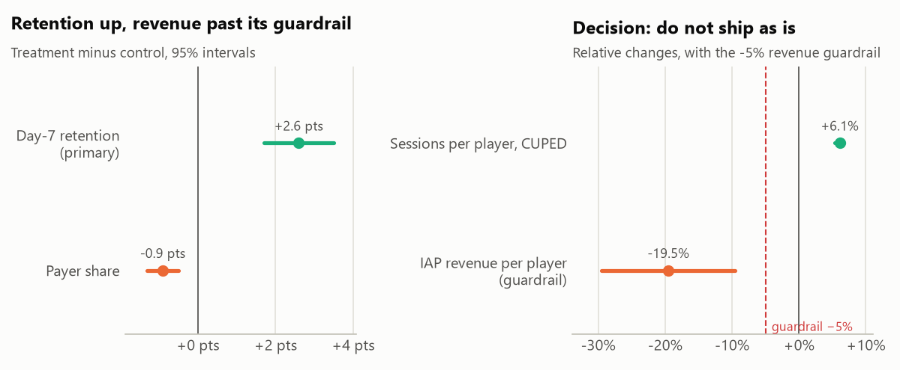
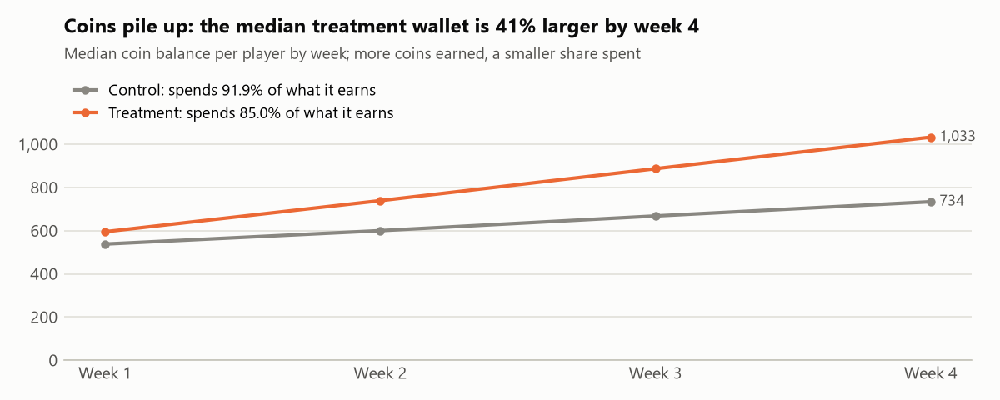
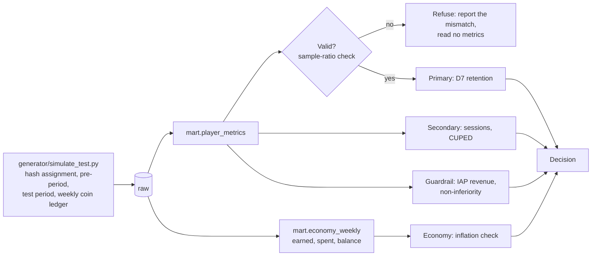

# Game Economy & Live-Ops Experiment

[](https://github.com/Saigwe/game-economy-liveops-test/actions/workflows/ci.yml)

> A full readout of a live-ops A/B test in a free-to-play mobile game: validity checks first, then retention, engagement with CUPED, a revenue guardrail and the health of the in-game coin economy. The test raises retention and still should not ship, and the readout says why. It also refuses a version of the same test with a broken split.

**Author:** Stanley Igwe, Lead Data (Analytics) Engineer · [Portfolio](https://saigwe.github.io)
**Stack:** Python · DuckDB SQL · NumPy / SciPy · pandas · pytest · GitHub Actions
**Data:** fully synthetic. The generator invents every player, session, purchase and coin. No real game, studio or player data is used.

---

## 90-second summary
| | |
|---|---|
| **Problem** | A game team wants to ease its hardest levels by giving more coins for clearing them. A retention bump looks like a win, but extra free currency can cut purchases and inflate the economy, and a broken split can fake the bump. |
| **What I built** | A generator for the test with known effects planted in it. SQL marts for per-player metrics and a weekly coin ledger (earned, spent, balance). A tested statistics toolkit (sample-ratio check, two-proportion test, CUPED, delta-method intervals, non-inferiority guardrail, sample size). A readout that checks validity before it reads any result and states a decision. |
| **Why it matters** | Live-ops decisions get made on one headline metric. This shows the full picture: the gain, what it costs, and whether the data can be trusted at all. |
| **Proof** | Every planted effect falls inside its interval. CUPED removes 78% of the variance in sessions. The A/A false-positive rate is about 5%. A logging bug that drops 6% of treatment players is caught (SRM p = 6e-8) before it can overstate retention. 12 pytest tests. See the [readout](results/readout.md). |

## Charts
Rendered from this repo's own results by `charts/make_charts.py` (`make charts`); CI re-renders them on every push.

These results also feed the **Economy & live-ops** page of the live studio dashboards: [saigwe.github.io/mobile-game-player-analytics](https://saigwe.github.io/mobile-game-player-analytics/).





## The readout in brief
| Metric | Change | 95% interval |
|---|---|---|
| Day-7 retention (primary) | **+2.6 pts** | +1.7 to +3.5 |
| Sessions per player, CUPED | +6.1% | +5.4% to +6.7% |
| Payer share | -0.9 pts | -1.3 to -0.5 |
| IAP revenue per player (guardrail, margin -5%) | **-19.5%** | -29.5% to -9.5% |
| Median coin balance, week 4 | **+41%** | |

**Decision: do not ship as is.** The retention gain is real, but purchases fall beyond the guardrail and coin balances pile up, because treatment players earn more and spend a smaller share of it (85% against 92%). Next step: test a smaller boost, or the boost with a matching coin sink.

## How the readout works

1. **Validity.** A chi-square sample-ratio check on the 50/50 split. If it fails (p < 0.001), the readout stops and reads no metrics. An A/A simulation confirms the retention test flags about 5% of no-difference splits.
2. **Primary metric.** Day-7 retention, two-proportion test.
3. **Secondary.** Sessions per player, with CUPED on each player's sessions in the 14 days before the test.
4. **Guardrail.** IAP revenue per player must not be plausibly worse than -5%: the low end of the interval has to stay above -5%. Revenue is heavy-tailed, so the interval for the relative change uses the delta method.
5. **Economy.** Weekly coins earned and spent per arm, and the median balance (starting from the 500 coins every player gets). The economy is flagged as inflating if the treatment balance ends more than 20% above control.
6. **Decision.** Ship only if retention is up, the guardrail holds and the economy is not inflating. Otherwise the readout says what failed.

## The broken split
A simulated crash on low-end devices stops 6% of the least engaged treatment players from logging their exposure. Read naively, retention would be up 3.3 points instead of the real 2.6, because the missing players are the ones who would have churned. The readout catches the 48.6% / 51.4% split (SRM p = 5.6e-8) and refuses to report any metric.

## Honest limits
- **The planted purchase effect is -10%** in the chance a player buys. The measured revenue change, -19.5%, is larger because revenue per payer is noisy; its interval (-29.5% to -9.5%) still contains the planted value.
- **One test, one seed.** The pytest suite also checks a version with no effects (decision: no ship) and the broken split, but a real programme would track many tests and correct for running many metrics at once.
- **The economy check is descriptive.** It shows balances diverging; a real team would also model how the surplus is spent over a longer horizon.

## Run it
```bash
pip install -r requirements.txt
make test    # 12 pytest tests
make all     # generate the test and its broken twin -> results/readout.md
```

## Tests
- **Toolkit (known answers):** the sample-ratio check passes a fair split and catches a 2% imbalance; the two-proportion interval matches a hand calculation; CUPED is unbiased and cuts variance by corr²; the relative-change interval covers a known 10% lift 92 to 98% of the time; the guardrail and the sample-size formula behave as expected.
- **End to end:** assignment is deterministic and balanced; the A/A rate is calibrated; every planted effect is inside its interval; CUPED narrows the interval without moving the estimate; the guardrail fails, the economy inflates and the decision holds back; a no-effect test is a no ship; the broken split is refused with no metrics read.
